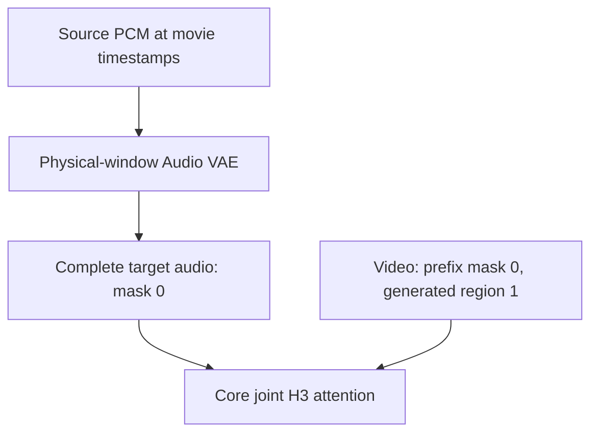

# Source Audio Locked (experimental)

Scene setup → **H3 audio generation** selects the model's target-audio behavior.
Existing projects default to **Guided audio**. Switching modes requires a new
take; previous takes keep their recorded settings.

| Mode | Model input |
| --- | --- |
| Guided audio | Existing source-audio conditioning keyframe; target audio is generated. |
| Source Audio Locked | Source PCM is Audio-VAE encoded for each physical window, copied into the complete target audio, and protected by Core's native zero denoise mask. |
| Generated audio | Driving Audio and Timeline guide-audio conditioning are disabled. Independent voice references remain active. |

**Final audio for new takes → Original / Generated H3 audio** is independent.
Original selects the connected source or routed original/authored soundtrack at
its movie timestamps. Generated selects decoded target audio. In locked mode,
that target is a VAE reconstruction of the source; only Original preserves the
source PCM directly. The final audio output must still reach Video Combine.

## Target and mask contract

`source_audio_lock.py` reuses the same native mask capability check as Native
Masked continuation. No Core class or sampler is replaced. The existing video
prefix mask is retained; the first chunk gets an all-one video mask. The full
audio mask is `[1,1,2,N]` zeros and target audio is `[1,32,2,N]`. The source latent
is copied into fresh target storage, never aliased. Generated audio from the
previous chunk is excluded from continuation context while the source is active.

Core `KSamplerX0Inpaint` injects protected audio **before** the model call.
`MiniMaxH3.scale_latent_inpaint` converts the carried audio schedule scale, and
`MiniMaxH3Model.forward` converts it back before audio embedding. Zero-mask audio
rows use the clean-audio timestep. Video queries can attend to those audio keys
through H3's joint attention. Core restores protected output values after the
call as well. The duplicate frame-zero driving-audio keyframe is omitted.

## Timing

All intervals use the unchanged 24 fps movie clock. Audio targets use 40 Hz;
the Audio VAE input rate must be divisible by 40. Native video geometry remains
`17k+5` frames, with its existing prefix trim and assembly contracts.

| Quantity | Definition |
| --- | --- |
| `O` | Actual job output start, including prior job overhang |
| `R` | Retained frames before this invocation |
| `C` | Frames trimmed from its continuation prefix |
| `P` | Physical PCM start: `O + R - C` |
| `A` | Prepared source origin: `max(0, O - 39)` |
| `F` | Physical native video frame count |
| `N` | Target audio ticks: `round(F × 40 / 24)` |
| PCM start in prepared source | `round(P × rate / 24) - round(A × rate / 24)` |
| PCM sample count for encoding | `N × rate / 40` |

The PCM window is selected before encoding. Independently rounded absolute
latent endpoints can differ from `N`, so the existing guide-latent slicer is
not used for locked targets. Latents are never interpolated or time-stretched.
The final tick covers at most half a 40 Hz tick beyond/before the video endpoint;
source soundtrack assembly keeps the exact authored duration independently.

For a 168-frame source inside a 175-frame native target, the target contains
292 audio ticks. Available source PCM is retained and the native overhang uses
**PCM silence encoded by the Audio VAE**, not a zero-valued latent. Continuing
source audio is used when it exists in the authored scene. Connected audio must
cover the authored interval; missing audio, short authored coverage, nonfinite
PCM, incompatible stereo/latent shapes, or missing native Core capabilities
produce explicit errors. Timeline guide gaps use the existing explicit silence
mix policy. Original PCM and its output position are never shifted by the lock.

## Persistence and refinement

The mode and `pcm_window_target_mask_v1` contract participate in per-window
sampling hashes and Run Storage's global Timeline contract. Source PCM hashes
include the bounded source interval. Guide-scope invalidation includes the
previous job's potential 39-frame source prefix. Guided legacy projects retain
their original hashes. Changing the final soundtrack alone does not change the
neural sampling identity. Source changes invalidate cached locked generation.

Exact Refine State transports the complete audio mask to the split audio
LATENT output. Downstream refiners must preserve that mask and Core's audio
schedule contract. A separate unmasked high-stage invocation can regenerate
locked audio and is not qualified by the sampler-boundary tests.

## Validation and limits

`tools/verify_source_audio_lock_core.py --comfy-root /path/to/ComfyUI` exercises
actual Core mask pooling, audio-scale conversion, `KSamplerX0Inpaint`, and joint
attention in an untrained tiny H3 on CPU. It asserts that source audio reaches
the audio embed input at each tested sigma, audio output remains fixed for
schedule scales 1 and 4, video remains generatable, and changing clean audio
changes video prediction. This establishes mechanism, not learned performance.

Unit and native-loop tests cover three chunks, nonintegral audio-grid starts,
resumed source prefixes, silence overhang, input immutability, source errors,
independent output audio, storage replay and mode/source invalidation.

The fast no-video-guide path remains available. Locked mode adds one Audio VAE
encode per sampled physical window and removes the duplicate conditioning-audio
tokens (584 rows for a 175-frame target). Actual latency and peak VRAM require
measurement. No GPU speed or memory improvement is claimed.

Spectrum's actual/forecast projection paths carry audio masks through the outer
Core forward contract; VDN and Sol attention retain target audio as global
context. Source inspection does not qualify every installed overlay or kernel.
GPU acceptance must compare Sage, Sage+Sol, Sage+Spectrum, and Sage+Sol+Spectrum
with identical media, prompts, weights/LoRAs, dimensions, seeds and schedules,
recording wall time and peak VRAM. Test both initial and resumed jobs and all
used refinement stages. Compare the unchanged guided control, internally
decoded target audio and original PCM, with frame-by-frame mouth/phoneme and
speaker-turn review. Speech activity alone cannot establish lip synchronization.

**Lip synchronization, facial quality, speaker attribution and camera continuity
remain empirical acceptance requirements.** The mask does not constrain shot
cuts. Keep the feature opt-in and the PR draft until trained GPU outputs are
reviewed. If target audio is correct while lips drift, investigate learned
cross-modal conditioning; do not retime the source soundtrack as a substitute.
