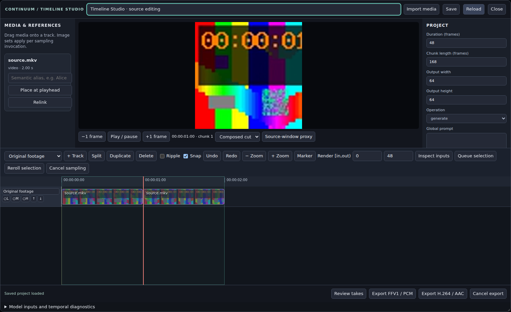

# Continuum Timeline Studio

Timeline Studio edits a media-light project and routes its effective prompts, image references, video guidance and audio to Continuum's native sampler. Retained footage and accepted generated takes form an independent output cut.

## Installation and compatibility

Install the Timeline Studio PR through ComfyUI Patcher, restart ComfyUI and reload the frontend. Existing V3.4 workflows keep their public node identifiers and widget ordering. Install the package requirements in ComfyUI's Python environment if its existing PyAV is older than 17. FFmpeg and FFprobe must be on the server's PATH. Media processing runs on the server's CPU; sampling still requires the normal H3 model, CLIP and VAEs.

The implementation has been exercised with ComfyUI 0.41.0 and frontend 1.55.18, including the actual canvas, workflow serializer and queue. Older frontend versions and every Nodes 2.0 renderer combination have not been qualified. Frontends that do not treat a native modal dialog as modal run ComfyUI's graph undo on Ctrl+Z even while the editor is open; that reloads the graph and closes the editor (observed with frontend 1.47.12, not with 1.55.17). No attention-provider or model allowlist is imposed. Keep Sol, Spectrum, Sage, VDN and LoRA patches upstream of the sampler, as in existing Continuum workflows.

## Quick start

1. Load `examples/timeline/Timeline_Studio_Generate.json`. Choose installed model, CLIP and VAE filenames. The example uses only Core nodes and Continuum.
2. Open **Continuum Timeline Studio**. The project stores the 24 fps output canvas, duration, chunk length and selected render interval. The sampler exposes width and height as ordinary graph-connectable controls. Chunk length uses output frames: 168 means seven seconds; the native supported range is 96–360 frames.
3. Write the global prompt or a Fixed, List or Timeline script. Add timed Prompt region tracks for more detailed scheduling. A double-click in a Prompt track creates a region.
4. Connect the typed timeline to **Continuum Timeline Sampler**. Its two latent lists go through Core video/audio VAE Decode, then **H3 Continuum Assemble V3.4**. Set **Timeline Output = Natural retained timeline (Refinement)**. Connect assembled images/audio and the sampler's take output to **Continuum Timeline Save Take**.
5. Choose **Queue selection** to reuse matching results, or **Reroll selection** to request a fresh alternative; each editor reroll asks native Run Storage to allocate a fresh nonce under its run lock, so restoring an old widget value cannot repeat an earlier alternative. Both queue immutable graph/project snapshots in submission order, after any work already queued, splitting selections longer than 16 chunks into ordered jobs. Rejected takes are never reused as a cached result. Editing the project afterwards does not change those queued inputs.
6. Open **Review takes**, preview an alternative, then accept/select it. The original take files remain available. Queue selection after rejecting the latest matching take requests a new native nonce, including when the graph is run directly. Normal queueing restores a selected rerolled take's stored seed schedule; explicit reroll inputs remain reproducible. The accepted take appears on the Generated takes lane. Generated audio automatically fills intervals without authored final audio; the authored soundtrack has precedence where it covers the accepted span.
7. To export a **specific movie snippet**, highlight its video clip in the timeline and use **Export clip/range · FFV1** or **Export clip/range · H.264**. The editor updates the displayed `Render [in,out)` to the clip's **absolute timeline start/end** before export. The input movie's separate **Source in** timestamp (e.g. 714 seconds) is preserved; it defines which part of the original movie fills that selected output interval. With **no retained/generated video clip highlighted**, the buttons export the explicitly configured `Render [in,out)` range. Multiple highlighted clips with different start/end times are rejected rather than silently exporting the wrong span. Export progress and duration refer to the actual snippet; completed files can be downloaded or found in ComfyUI's output directory. The native Export node honors the saved render range.

## How selected footage reaches MiniMax-H3

**The Export buttons do not feed the sampler.** They write finished FFV1/MKV or H.264/MP4 files into ComfyUI's output directory. The separate **Continuum Timeline Export** output node returns only the finished file path.

For **Generate** or **Replace**, select **one retained video clip** and click **Guide H3 with selected clip** (toolbar or clip inspector). This creates/refreshes an explicit **Video guidance** track referencing the original registered media and its authored source-in PTS/speed. It also sets Render [in,out) to the clip. **Queue selection** sends a saved project snapshot through **Continuum Timeline Studio → Continuum Timeline Sampler → per-chunk video reference encoding → native MiniMax-H3 sampling**. Nothing is exported or re-imported on this path. **Inspect inputs** shows the actual compiled video-guidance windows. The output is new generated takes, which the assembler decodes and **Save Take** records for Review takes.

For **Recreate**, retained video is already used as guidance in its chunk unless an explicit Video guidance clip is present; the same button can make a particular retained clip's routing explicit. Model guidance is conditioned on the source frames and is not a pixel-exact pass-through or a guarantee that all details and motion are reproduced. Audio is routed independently.

## Export geometry and fidelity

The editor's **Export pixels** control defaults to **Original source resolution** for selected video clips. For example, selecting a 1920×1080 movie clip on a 768×512 H3 sampling canvas exports **1920×1080** pixels, without downscaling to the generation canvas. A source-resolved export recomposes and re-encodes the selected timeline window; it is not bitstream-copy/remux of the original. FFV1 is lossless for the compositor's **8-bit RGB conversion**, but higher-bit-depth/HDR sources may lose precision/transfer characteristics. The timeline always remains 24 fps, so sources with other frame rates are sampled to the output clock.

**H3 sampling canvas** explicitly produces the lower/different timeline project width/height instead. Source resolution requires an unambiguous selected visual clip, or overlapping video clips with the same native geometry. For mixed-size material highlight the intended visual clip or choose the sampling canvas; the server never silently substitutes the lower-resolution canvas when Original source resolution is requested. H.264 requires even dimensions; use FFV1 for odd-sized native frames. The independent optional **Continuum Timeline Export** node keeps Timeline canvas as the default for existing workflows, with a Source resolution selector when desired.

## Media Resolution wildcard input compatibility

Studio follows ComfyUI's actual linked reference IMAGE inputs upstream through
single-source pass-through and Media Resolution nodes. These nodes may expose
generic or wildcard LiteGraph input types; source inspection now examines
connected input, link and origin-output types rather than relying on an input
named exactly `image` with type `IMAGE`. Non-image megapixel/width/height
controls are excluded, and multi-image processors cannot be assigned an
arbitrary single-source thumbnail. Image Conveyor reference outputs also have
a stable output-index fallback for environments missing their output labels.

A Conveyor shelf file can be represented by an annotated relative path,
`relative_path`, or the `subfolder` plus `filename` supplied by its
normalized metadata. Path traversal and absolute filesystem locations are
rejected. Thumbnail URLs use ComfyUI's own API base path and the Conveyor's
authenticated thumbnail endpoint. If a specific reference cannot be traced,
the card reports why, rather than presenting an unexplained missing thumbnail.
The Studio browser/backend/Windows compatibility string is
`h3-timeline-conveyor-preview-v9`. Refresh the ComfyUI frontend after a
Patcher overlay update so the versioned module is loaded.

## Select active Image Conveyor references for each H3 chunk

The chunk editor presents **one image thumbnail and one checkbox for each
currently available Image Conveyor reference**, not the entire upstream shelf
repeated under each sampler input. Availability follows the Conveyor's
persistent-mode shelf contents and global reference-output toggle mask:
`image_conveyor_reference_enabled` on the live node, falling back to its
backend-visible `reference_output_enabled` state. Connected sockets without
an enabled and populated Conveyor shelf reference are omitted from the chunk
picker. For example, if only the first four of eight Conveyor outputs are
active, each chunk displays four selectable reference images.

The checkboxes control the existing physical sampler `reference_image_N`
inputs independently for each chunk; switching off one reference in chunk 1
does not alter chunk 2 or the Conveyor's global state. With no explicit chunk
override, all upstream-connected references are inherited and the Conveyor
decides which outputs actually produce nonempty tensors. Once a user edits a
chunk, the saved selection records its chosen socket indices. Resetting a
chunk to **Inherit active references** removes that override, including any
historical selections no longer visible due to global toggle changes.

When the IMAGE processing node exposes multiple input paths, the UI can show
the original Conveyor image with the matching reference ordinal; it must not
claim the exact post-processor pixels can be recovered from the graph without
an explicit routing contract. The checker still enables/disables the sampler
IMAGE socket itself. Changes to the Conveyor's active shelf or output mask
refresh the displayed choices without copying any image into Timeline Studio.

## Multi-input Image Conveyor provenance

A sampler reference can be produced by an upstream IMAGE processor that
combines several IMAGE inputs. In that case there is no sound way to infer a
single original thumbnail from the static connection graph. Timeline Studio
shows a horizontally scrollable gallery of all **definitely reachable Image
Conveyor shelf originals** for that reference socket, with filenames and
shelf numbers. The gallery is explicitly identified as *upstream source
images*; it does not claim any individual original represents the exact
processed result. Click a candidate to inspect its larger original image.

Single-image processor chains continue to display one original thumbnail
with the intervening processing path. When no reachable Conveyor shelf source
can be proven, the card reports the unresolved lineage rather than inventing
a thumbnail. The gallery only inspects graph metadata and original shelf
thumbnail URLs; the ComfyUI node chain still supplies the actual IMAGE tensor
to MiniMax-H3. Checking a reference remains a per-chunk selection of the
connected sampler socket, not a selection of gallery candidate files.

## Reference thumbnails, intermediate processors and viewer behavior

Connected references may pass through a one-to-one IMAGE processor such as
a Media Resolution node before reaching the Continuum Timeline Sampler. Studio
traces those connections back to Image Conveyor without bypassing or changing
their processing. The displayed thumbnail represents the Conveyor shelf's
**original image**, not the resized/processed tensor; each row identifies
intermediate processing nodes. Click a thumbnail to inspect a larger original
preview. Ambiguous multi-image processing branches are not guessed: Studio
labels them as connected IMAGE sources without claiming a particular Conveyor
shelf image. Dynamic Conveyor queue-group references cannot show a stable
image until execution.

Reference shelf/preset and global output-toggle changes update the source
thumbnails while Studio is open; the refresh control remains available.
Chunk checkbox changes update saved sampler inputs without restarting source
movie playback. The compact Connected Sampler row expands to show all
persistent model and sampler settings. Chunk cards share a scroll area rather
than each requiring a separate scrolling region.

When source-frame seeking takes time, the viewer first reuses a nearby already-decoded filmstrip tile where available, without launching a duplicate low-resolution decoder seek. Otherwise it requests a temporary source thumbnail. It explicitly labels this temporary approximation until the exact high-detail source frame arrives. A failed decoder request is reported with a
suggested proxy-mode retry. Temporary viewer thumbnails are never used for
sampling or final clip export.

## Image Conveyor reference selection per chunk

**Reference images are supplied by existing Image Conveyor connections.** Connect the Conveyor's `ref_image_1` through `ref_image_8` outputs to the Continuum Timeline Sampler's `reference_image_1` through `reference_image_8` IMAGE inputs. Every chunk card lists its connected sockets, the current Conveyor shelf filename/thumbnail where available, and an enable/disable checkbox. **Do not import images again to populate chunk reference slots.** The timeline stores only an explicit set of selected *socket numbers* for each logical chunk. Unselected sockets are omitted from that chunk's actual physical reference-conditioning tensors, including lookahead; other chunks keep their own selections.

**Default for existing workflows:** no explicit selection means every connected socket is inherited. Untick a checkbox to create a chunk-specific selection. All references can be unticked, giving that chunk no persistent IMAGE references. **Inherit connected references** removes the chunk override and restores legacy behavior. Connected Conveyor slots that are empty or globally disabled still provide no IMAGE; the card identifies them as currently inactive. A global Conveyor output toggle and the chunk-local checkbox are separate controls. Connected non-Conveyor IMAGE sources can also appear as socket providers, with their actual upstream node label; the sampler contract is unchanged.

Conveyor shelf files remain owned by Image Conveyor. Editing its Reference Shelf or applying a new preset changes which actual images reach each enabled socket on subsequent queue submissions; the timeline does not serialize image tensors, duplicate files, or maintain an independent shelf. **Refresh Conveyor connections** updates filenames/previews after changing the shelf while Studio is open. When a source is dynamically determined at execution time, its exact pixels are resolved by the connected graph, not inferred from a cached thumbnail.

Images are numbered **contiguously** for each physical H3 invocation in selected socket order, followed by any legacy imported-scoped image-reference clips. Unselected slots do not consume a Picture number. The per-chunk summary reports selected connected sockets and warns if the possible total exceeds eight; the runtime checks actual nonempty tensors. Changing a selection updates the causal generation hash, invalidates that chunk's stored take and its dependent continuation suffix, and applies equally to actual sampling and speculative lookahead.

Changing logical chunk duration reflows masks together with chunk-authored inputs. Selection conflicts that would collapse separately configured mask entries into one chunk are rejected before modifying the project. Pre-existing file-based reference clips remain readable for backward compatibility, but the chunk authoring UI no longer offers imported-image reference assignment.

## Navigate the complete source timeline

The timeline's horizontal extent always represents the **entire movie**, even
when the H3 render selection covers only a few chunks. The selected render
range remains visibly highlighted and does not restrict scrubbing, seeking,
scrolling or frame stepping. Use the horizontal scrollbar, trackpad horizontal
gesture, or **Alt+mouse-wheel** to pan. Ordinary vertical mouse-wheel
scrolling over the movie ruler or track content zooms around the cursor.
**Fit selection** zooms to the current render selection without clipping the
rest of the movie; **Fit movie** zooms out to its full duration. **Jump to selection** returns the
playhead and viewport to the chosen generation range. These actions update
view-only state and do not change render in/out, accepted takes or sampling.

## Activate or deactivate media for an individual chunk

The selected-clip Inspector also exposes a whole-clip Active checkbox, clearly scoped to the clip's entire timeline span. Use the chunk card checkbox for changes limited to a single chunk.

Every chunk card separates **the chunk prompt**, **Image Conveyor references**,
**adding video or audio** and **media already on the chunk**. The media area
shows original footage, video guidance and audio clips, including inactive
clips. Each media item has an **active** checkbox. Unchecking a video-guidance
or audio item excludes it from the corresponding H3 conditioning/output
according to its track role. Original-footage activation controls its timeline
contribution; in Recreate, retained footage can also supply implicit guidance
when no explicit video guide exists. Track-wide mute remains a separate global
control. An item on a globally muted or locked track must be unmuted/unlocked
there before its per-chunk activation can be edited.

For a source clip spanning more than one chunk, a chunk-local toggle splits
the clip at that chunk's output-frame boundaries while preserving its original
source time, speed, and media settings in neighboring chunks. A clip with a
time-based fade cannot be split transparently without changing the envelope;
the editor refuses that operation with a precise diagnostic so the fade can
be adjusted using the timeline editing controls. Undo restores the previous
clip structure.

The reference-image area has **All**, **None**, and **Reset** actions for the
currently available Conveyor images. These apply only to that chunk. Reset
returns to inheriting the globally enabled Conveyor references. Reference
images remain connected IMAGE inputs rather than imported copies.

## Timeline navigation and chunk media switches

The lower track timeline navigates the full source duration. Scroll the mouse
wheel over the ruler or any timeline track to zoom around the mouse cursor;
horizontal trackpad gestures and Alt+wheel pan. Shift+wheel scrolls tracks
vertically. The toolbar also offers **← Pan**, **Pan →**, **Fit selection** and
**Fit movie**. Pan changes the visible range, not the selected H3 generation
interval, clip positions or source PTS. Zoom changes only view magnification.
Ctrl/Command-wheel remains available for the browser's native zoom action.

For each H3 chunk, the **Media in this chunk · enable / disable** section
lists footage, H3 video guidance and audio (including globally muted clips).
Each media entry has an enabled checkbox plus its role and clip identity.
Toggling a spanning clip isolates that chunk's interval and preserves the
neighboring chunks; clips with overlapping fades require an explicit trim
decision instead of silently changing their gain shape. A locked or globally
muted track explains why the checkbox is unavailable and provides an
**Unlock track** or **Unmute track** control. Those global actions affect the
whole track, so use them deliberately. **Add video or audio to this chunk**
is collapsed until needed to keep the active inputs readable.

## Resizing the Timeline Studio workspace

Timeline Studio is a resizable modal. Drag the **horizontal grip below the
source preview** to make the video/image viewer taller or shorter; drag the
**grip above the track timeline** to allocate height between the H3 chunk
editor and the track canvas. The timeline retains a minimum usable height,
and the editor automatically reallocates remaining space within the current
window. Drag the **vertical grips** between the media library and preview, or
between the preview and inspector, to resize the two sidebars. The center
viewer stays usable even when both sidebars grow.

The H3 chunk heading provides live size controls for **chunk-card width**,
**reference-image thumbnail size**, and **track height**. Prompt textareas
already have their own vertical resize grips. The dialog itself can be
resized using its lower-right corner. **Reset panel sizes** restores the
responsive default layout. Splitter handles are keyboard accessible:
focus a grip and use the arrow keys; double-click a grip to reset its
dimension. Resizing the browser or modal constrains sizes automatically
without discarding the preferred values.

Layout values are stored in the Timeline Studio node's
`h3_timeline_view.layout` properties, not in `project_json`. They persist
with the ComfyUI workflow without modifying the selected H3 chunks,
source image tensors, prompt text, sampling inputs or final export
dimensions. The top preview is independently sized and will no longer be
shrunk automatically merely because the chunk editor is expanded.

## Scene-first generation (no manual movie splitting)

Import or place a video containing an audio stream. Its original soundtrack is
carried on that **same retained video clip** as both native H3 audio guidance
and final soundtrack. Moving, trimming or splitting the video therefore moves
its audio at the same source PTS. Older projects with a separate original
soundtrack track are supported: **Start scene** routes the retained video's
embedded audio as H3 guidance while leaving the original final track in place
to avoid doubling the audio. A video added directly to a Video guidance lane likewise supplies its embedded
audio as guide and final by default. If identical source audio is already
routed by the original clip or a legacy soundtrack, only the missing audio
role is added, preventing duplicate playback. A connected sampler `driving_audio` input still
takes priority over Timeline Studio guide lanes.

Seek to the first desired source-film frame, enter **Chunks** and
**Seconds per chunk**, and click **Create scene from playhead**. For exact
numeric entry, expand **Specify exact source frame**. Scene creation
reconstructs the registered uncut original video and its synchronized
soundtrack before deriving all H3 chunks. Previous cuts, mute partitions,
stale guide lanes, scene-local media overrides and accepted placements are
cleared in one Undo-capable edit. The connected State Manager prompt,
registered original source files and saved take payloads are preserved.
If several different source films are present, select the intended original
film first; the editor does not guess. For example, two 168-frame chunks starting at frame 14955 cover
[14955,15123) and [15123,15291). These are *virtual boundaries*: the movie
and its original soundtrack remain whole, and each H3 invocation obtains only
the corresponding source video/audio interval from its original source PTS.
A span extending beyond the movie is rejected.

**Merge matching splits** is available under **Advanced timeline editing**,
with **Merge adjacent** in the context menu and the `J` shortcut. It rejoins
source-continuous clips only when their mute, fade, audio routing and all
other settings agree. Pieces with different audio routing or modified source
timestamps intentionally cannot be merged without changing behavior. Use
**Create scene from playhead** or **Restore uncut original** for a clean
source-film timeline instead. Gaps, fades and muted
discontinuities are never silently merged. **Restore original movie** returns
the timeline to a single uncut source movie with its embedded audio, removing
the current cuts, chunk-specific inputs and accepted placements. It requires
confirmation and supports Undo. It does not delete registered source files
or saved take payloads. When several movies are registered, select the
intended original clip first.

If an authored original/final soundtrack covers the entire intended movie
scene, the Timeline sampler supplies that PCM to the V3.4 assembler, which
bypasses the generated audio. Native H3 may produce extra frames beyond the
requested scene; their audio is silence, not invented dialogue. Use exact
duration assembly when the output must end precisely with the original
soundtrack. Partially covered final tracks do not erase uncovered output
with silence. Native H3 Driving Audio conditions the visuals, but lip-sync
accuracy remains model-dependent and requires GPU validation.

## Chunk-first generation authoring

Timeline Studio opens in **Chunk-focused timeline** mode. The horizontal H3 input cards represent only the selected logical generation chunks, not the full duration of a source movie. Every card displays its absolute output frame/time window and lets you author a **per-chunk prompt**, select/deselect connected **Image Conveyor reference images**, add **video guidance cuts**, or add **audio cuts** explicitly routed as `guide`, `reference`, `final` or `both`. Eight chunks are shown per page to avoid constructing a large DOM for a multi-hour project. The original full-film editing view remains accessible by disabling **Chunk-focused timeline**. The chunk count and seconds controls are bidirectional with the connected Continuum Timeline Sampler's `chunks` and `chunk_seconds` widgets; all generation windows remain on the 24 fps frame grid.

For video and audio, each card's media selectors use previously imported registered assets; dragging video or audio from **Media & references** onto a card assigns it to that chunk. Dragging an original video/audio file from Windows Explorer uses the authenticated Timeline Desktop bridge to register the original without scanning or copying the movie. New video/audio assignments create real `video_guide` or `audio` clips with **start/end exactly matching the chunk**. **Images are not imported or copied into chunk reference slots:** choose them using the connected Image Conveyor reference checkboxes above. When a new guide references the corresponding retained original, its source-in PTS matches that source's absolute time (e.g., a late scene hundreds of seconds into a movie). Other media starts at its registered stream origin; edit **Source PTS (s)** to select a different cut. The card shows the derived source-out time. Imported originals and manually trimmed spanning clips are preserved and can still be edited using the ordinary timeline track inspector.

Typing a chunk prompt creates an exact `prompt` track clip marked as a chunk-authored override. The global prompt still applies; the inherited project script is replaced *within that chunk only*. When a native `sequence_prompt` input is connected, its prompt remains the fallback for chunks without explicit new chunk prompts. Legacy free-form prompt regions retain their established behavior under the connected input, but **new chunk-authored prompts have precedence in their own windows**. Sampling and stale-take checks use the same resolution rule. The per-card compiled summary comes from the actual project compiler; an external connected `sequence_prompt` cannot be fully decoded by this project-only inspection, so the editor labels the external fallback and explicit override rather than inventing an effective string.

The **Connected sampler** panel reports the selected chunk count/duration, actual node seed, dimensions or externally linked width/height, reference sizing, continuity/run storage and persistent connection slots. It explicitly identifies when connected `driving_audio` takes precedence over authored guide-audio lanes, when a persistent video reference supplies unguided chunks, and when model inputs are supplied outside the timeline. In particular, *final audio* is not an H3 driving source unless also routed as `guide` or `both`. Image references are still subject to the existing model limit of eight combined persistent and scoped active pictures. The per-chunk compiled summary warns when connected persistent image sockets plus scoped references could exceed the limit; because connected sockets can resolve to empty values, the definitive count remains the sampler's runtime validation.

Changing the **chunk duration** also reflows explicit Image Conveyor slot selections, rejecting collisions before applying edits. It re-quantizes the selected render window to the scene-anchored 24 fps chunk grid and follows authored chunk clips in order across that selected region. It preserves each media cut's source-in PTS and speed, updating its output duration. This keeps the scene's start frame fixed while updating later virtual chunk boundaries; verify the displayed timecodes after changing duration. Ordinary manually authored timeline clips are not silently moved. This operation is undoable. The remaining native sampler fields stay on the existing V3.4 sampler node and retain their execution semantics.

## Original sampler controls

The Timeline sampler shares its native control definitions with **H3 Continuum Sampler V3.4**. Its graph inputs retain the model/CLIP/VAEs, sampler and sigma schedule, first/last images, eight persistent reference-image sockets, Video Reference and Driving Audio. Reference sockets expand as they are connected, as on V3.4. The original V3.4 node remains available.

| Control or feature | Timeline location and behavior |
| --- | --- |
| Chunks / chunk seconds | Editable on the sampler in V3.4 order. These project-bound controls update Studio’s render selection and chunk length, including an open editor and its undo history. Chunk count describes the selected logical chunks; selections longer than 16 are submitted as bounded jobs. Chunk seconds is quantized to the 24 fps output frame grid. Studio’s inspector edits the same data. |
| Width / height | Native integer widgets and connectable INT inputs on the sampler. Unlinked edits update Studio’s canvas too. Connected values are resolved during execution and determine the actual latent dimensions. Accepting the take adopts its resolved canvas while the project still has the frozen source canvas; a later explicit canvas edit is preserved. Old API graphs that omit these inputs retain the project’s dimensions. |
| Sequence Prompt / Prompt Format | The connected State Manager Text Box or another STRING source supplies the inherited script; the per-chunk prompt boxes are optional overrides. The Studio recognizes valid `[0-7s]`-style sections as Timeline syntax even if an old Timeline Sampler widget still says List; JSON lists and `---`-separated lists keep their existing indexing. Absolute timestamps overlapping the current movie position use the project clock. When a zero-based scene script ends before a later selected movie position, its clock starts at that selected job's first chunk; subsequent selections reuse the earliest sampled take's origin for the identical source text. Edit a script to start a new scene clock, or use project-absolute timestamps to bind prompts to specific movie times. A source that cannot be recognized retains the native permissive fallback. Managed prompt provenance remains supported. |
| Base seed / control after generate | Standard Core fixed/increment/decrement/randomize widget. Studio advances seed controls once per submitted batch; every job in that frozen batch shares the base seed and adds its chunk offset. |
| Continuity, continuation method, audio continuity | Sampler controls passed to the same native continuation runtime. The existing native mask/AV requirements still apply. |
| Run Storage / Run Name | Save + Auto Resume (Timeline default), or Off. A name overrides the storage namespace; job and causal-parent suffixes keep separate chains separate. Off samples the entire job without reading or writing the raw chunk cache. Immutable take metadata and continuation sessions are still saved for review and chaining. |
| Regenerate From / Variation Nonce | Sampler inputs; 0 means Auto. Explicit boundaries are one-based within the selected job. Studio rerolls request a new native nonce. With storage Off, the entire job is sampled even when a suffix seed boundary is supplied. |
| Reference Size | Match Output or Max Identity, applied to persistent and scoped stills. Persistent pictures are numbered first; scoped `@aliases` follow them. The combined limit remains eight active pictures. |
| Video Reference Size | Efficient, Balanced or Match Output, applied to both persistent video and scoped guidance. Scoped video replaces persistent Video Reference in the windows where it is active; persistent video is used elsewhere. |
| Driving Audio | Connected audio overrides authored guide lanes and supplies final audio. Unconnected projects route the original movie's embedded soundtrack to H3 conditioning and, when the authored final soundtrack fully covers the job, preserve it through the V3.4 assembler instead of using H3-generated sound. |
| Qwen Lookahead | Sampler switch using the native bounded CPU prefetch and descriptor checks. Eligible stable-geometry windows can pre-encode the next prompt and image references. Scoped video/voice windows and motion-dependent unknown geometry stay sequential. |
| Report detail, developer diagnostics, sampling preview | Same Continuum application settings as V3.4; the corresponding API inputs reach native sampling. |
| Exact Refine State | Connecting `refine_state` enables capture, as on V3.4. Every chunk is sampled again so states and masks match all latent outputs. Save + Auto Resume allocates a fresh native variation for that execution. |

Saved Timeline workflows migrate positional widget values to named values before applying the V3.4 visual order. Old seven-widget and expanded layouts preserve their saved seeds, regeneration boundaries, nonces and canvas dimensions. Connected socket slot indices are remapped while retaining link identities. Existing Timeline output indices are preserved; `driving_audio` is appended. The supplied Generate/Recreate/Replace workflows include the sampler controls in this order. Sequence Prompt precedes first/last images; image reference sockets remain contiguous as they expand to eight; Video Reference, Driving Audio and Audio VAE follow them. Job index follows the ordinary sampling controls.

## Importing and editing a movie

**Use Continuum Timeline Desktop on Windows, not an ordinary Chrome tab.**
The desktop wrapper hosts your same ComfyUI frontend and uses Electron's
native Explorer file-path API in an isolated preload. A one-time Windows
portable application is required because browsers deliberately hide the
original full path. See [Windows wrapper setup](../../desktop/timeline-native/README.md).
After launching it, **drag the movie from Windows Explorer** into Timeline
Studio or click Import media. No per-video paths, settings, scans, search
indexing, uploads or movie duplicates. The same applies to Relink.

The isolated desktop bridge privately translates the *selected* Windows drive
path to its exact WSL mount location, e.g. `D:\\Videos\\film.mkv` to
`/mnt/d/Videos/film.mkv`. It submits the path to the same-origin
`/h3_continuum/timeline/link` endpoint, without disclosing the absolute path
to page JavaScript. The backend checks that the source is a regular file under
an allowed mounted root, reads it once to establish its SHA-256 identity, probes
the media, and stores only a tiny persistent path pointer. There is **no
recursive directory traversal**, Windows Search, guessing from file name,
browser movie-byte transfer, or full source movie copy. A previously stored
managed copy with an identical hash is retained instead of silently deleted.
The original must remain at its current path and unchanged for subsequent
playback, sampling and export, including after a ComfyUI restart. Invalid or
missing drives fail explicitly; there is no upload fallback.

Ordinary Chrome **cannot** supply a native path and now displays an explicit
zero-copy desktop requirement; it will not attempt a drive scan. The legacy
`/import` HTTP API still exists solely for external clients and is not
called by Studio drag, file-picker or relink.

Full-stream decoded audio caching is off by default. Set
`H3_TIMELINE_PCM_CACHE_GB` to opt into its disk cache; disabling it can slow
repeated late audio seeks. Bounded preview proxies, generated takes and exports
still consume disk, but **import never duplicates the original movie**.
Set the project duration and render out as intended. Two-hour sources are
decoded in selected video/audio windows, not into a full-film IMAGE batch.

Drag an asset card onto an existing track to place another selection. Set the clip's source in and out in absolute source PTS seconds, and timeline in/out in output frames. Track order is bottom-to-top composition precedence: the last active footage track owns overlapping video. Hidden changes display; muted changes output. Locked tracks resist timeline editing operations.

Select clips with click or Shift-click. Drag to move; drag edge handles to trim; Alt-drag slips the source while retaining placement. Split, Duplicate and Delete operate on the selection. Ripple deletion cuts the same time intervals from every unlocked track, including spanning soundtracks, and closes the cut. Source mapping, markers, selection and project duration follow the cut; locked tracks keep their placement. Ripple extension inserts time in other unlocked lanes, splitting spanning clips around an explicit gap. Snapping includes chunk boundaries, markers and clip edges. Zoom and horizontal scroll expose distant parts of a long film. Filmstrip and waveform requests cover visible windows on fixed tiles, so scrolling only fetches new tiles and revisited ones come from the browser cache.

Filmstrip thumbnails and visual waveforms now use cancellation-aware, short-window media reads. Audio waveforms use direct PTS seeking rather than the sample-exact long-prefix decoder, so scrolling to late parts of a two-hour source cannot intentionally decode the entire preceding movie for each tile. Requests abandoned during rapid seeking/scrolling signal the backend to cancel their CPU/FFmpeg work.

The inspector edits source ranges, speed, gain, fades, aliases and routing. Positive or negative speed is an explicit retime; audio retiming changes pitch. Audio loops and pitch-preserving time stretch are not inferred. Missing source material uses the declared clip policy: Error, Hold for video, or Silence for audio. New audio clips default to Silence because an audio stream commonly ends a few milliseconds before its video; other clips default to Error. Output gaps are black video and silence. Scaling uses aspect-preserving containment with black borders.

Markers can have names and end frames, making named render regions. Project in/out and every clip interval are half-open `[in,out)`.

| Shortcut | Operation |
| --- | --- |
| Left / Right | Step one output frame |
| Space | Play/pause a bounded composed preview with final audio |
| S | Split at the playhead |
| I / O | Set render in / exclusive render out |
| Delete / Backspace | Delete selected clips |
| Ctrl/Cmd+C, V | Copy/paste clips |
| Ctrl/Cmd+Z, Shift+Z | Undo/redo |
| Ctrl/Cmd+S | Save |

Shortcuts are scoped to the editor and suppressed in text inputs. While the editor is open, its key presses do not reach ComfyUI's graph shortcuts. Closing an editor or changing workflows disposes its listeners and media elements. Duplicating or pasting a Studio node, including pasting one clipboard several times, creates an independent project ID and retains immutable media references. Copied generated footage becomes independent retained footage, without borrowing another project's continuation state.

## Generate, recreate and replace

**Generate** uses the prompts and explicitly scheduled model conditions. A retained movie is not automatically a video reference in this mode.

**Recreate** interprets the selected original footage as visual guidance unless an explicit Video guidance track supplies it. A retained clip can disable this automatic video use in its inspector. Audio remains independently routed. This creates a new interpretation, not pixel-accurate reconstruction.

**Replace** generates selected intervals and composites accepted footage only into those intervals. Original footage remains authoritative outside the replacement. When no first frame is connected to the sampler, the first generated frame of a chain is anchored to the retained frame at the job start; a replacement whose render-in lies on a chunk boundary therefore begins from the frame it replaces. Cuts inside a continuous shot are still not guaranteed seamless. Regenerating native continuation changes the causal state; later generated footage can become stale even if its text is unchanged.

For a movie's audio without its video, use an Audio clip with Guide, Final or Both and disable video guidance for that span. Final-only changes do not participate in diffusion identities. Accepted generated audio fills only sample intervals without authored final audio; moving or muting an authored soundtrack updates this fallback automatically. Guide-only audio is model conditioning; it is not automatically copied into the output. Final means preserved/mixed PCM without model guidance. Reference means voice/style conditioning without final-copy intent. Neither disables audio use. No route promises guaranteed lip synchronization or voice identity.

## References and prompt routing

An Image reference set track scopes reusable still images to intervals. Give an asset or clip a semantic alias, such as `Alice`, and write `@Alice`. Each invocation resolves active images into contiguous public `<Picture N>` tags. First/last presentation is then remapped by the existing Qwen encoder; the actual mapping is recorded in the input inspector. The limit is eight active reference images per invocation, rather than eight assets per project. These are appearance references, not guaranteed frame-local keyframes.

Video guidance selects only the source intervals intersecting that logical chunk. A seven-second source interval remains seven seconds even when the native reference tensor is padded to a `17k+5` length. The added reference frames explicitly hold the last selected frame. No neighboring source window is used as padding. When guidance covers only part of a chunk, uncovered frames hold the nearest guide frame and the chunk reports a warning in Inspect inputs and the sampler status.

Fixed/List/Timeline parsing retains the existing permissive fallback, except that the Timeline Sampler prioritizes explicit time-section syntax over a stale List selector and can preserve valid movie-absolute sections beyond the native 16-chunk preflight. The standalone native sampler retains its established format semantics. Exact outer chunk headers route only their own bodies. Prompt tracks add timed regions; Override replaces inherited script text inside its own span while retaining the global prompt. Each chunk becomes an outer section on its exact chunk boundary and its timed regions become a strict inner partition, so the native physical compiler places them on each invocation's own clock, including native context, without importing neighboring chunks. An `@alias` without an active image in a chunk is passed through unchanged and reported as a warning. Inspect inputs shows the logical schedule; sampled takes add the actual descriptor, compiled text, Qwen mapping, source selections and reuse flags.

## Native time and continuation

The editor distinguishes source PTS, output frames, logical chunk windows and physical H3 windows. Native sample boundaries need not fall at seven-second edges. The first seven-second sample normally occupies 175 physical frames. Continuation adds protected context and native rounding; that context is never counted as fresh output. Native geometry remains owned by Continuum. First/last-frame inputs anchor the boundaries of the selected generation chain.

The compiler includes the compatible accepted prefix and its bounded causal job suffix when rerendering an internal selected chunk; only the chosen output interval is composited. Run Storage authenticates it against effective media, text, model/CLIP/VAE/sampler identities and the sigma schedule. Changing chunk N’s visual conditions invalidates its causal suffix. Guide-audio edits invalidate every window of a job whose actual encoded guide range contains the edit, until narrower Audio VAE dependencies and phase behavior are qualified. The range follows cumulative native output placement across jobs. Takes using the older margin-based guide identity regenerate once. Edits elsewhere in the project leave that job's takes valid. A different accepted upstream take also changes downstream lineage. Valid preceding output is reusable; stale generated footage is rejected by composition rather than advertised as valid.

Jobs retain natural output while transferring native state. Their recorded physical output ranges determine placement across job boundaries. Only the selected intersection is placed in the cut. Use Natural retained timeline at the assembler: cropping each job independently would discard material needed to preserve the native chain. Timeline Studio disables terminal FL2VA grouping for its scoped jobs and uses separate invocations; legacy V3.4 grouping remains unchanged.

## Persistence, relinking and recovery

Save persists the project with an optimistic revision check. Reload restores its last saved manifest. Workflow JSON stores the same media-light project, never full video or latent tensors. Scroll, zoom, playhead and selection are saved in the node's properties; they are not prompt inputs, so they never invalidate cached execution. Saving concurrently from another editor produces a revision diagnostic instead of silently overwriting it.

The asset library's Relink action imports replacement content and updates clip references. Changed content gets a new content ID, invalidating affected conditioning. Missing or externally altered registered files must be relinked before sampling. Keep the `input/h3_timeline_studio` directory when moving an installation; keep Continuum Run Storage, session files and outputs to retain generation history.

With Run Storage enabled, sampling commits each completed chunk through native Run Storage. A cancelled or failed job keeps its valid completed prefix. Take specifications and their native sessions are immutable; review selection is project state. Exact Refine State forces sampling from the first job chunk so every emitted state matches its latent. It uses the existing `H3_CONTINUUM_REFINE_STATE` contract; optional downstream algorithms remain external.

## Export and performance policies

Export uses **the dimensions explicitly selected for the delivery file** (original source or H3 sampling canvas), independently of the H3 sampling dimensions, and decodes bounded RGB blocks. Both **FFV1/32-bit float PCM in MKV** and **H.264/AAC in MP4** now encode and mux directly into one atomic output rather than building an enormous temporary FFV1 movie followed by a second full-film re-encode. Lossless export preserves normalized 8-bit SDR RGB pixels and float PCM after declared frame sampling, scaling, channel mapping, gain and mixing; H.264/AAC is a delivery re-encode. Mono audio maps into the stereo mix at unchanged amplitude; the default output rate follows the first audio asset or 48 kHz. Peaks above full scale are clipped after summation, and crossfades use overlapping clips and their fades. The editor now displays **encoding progress** and provides a **Download** link when the finished file has been committed in ComfyUI's output directory. Export cancellation removes partial outputs and temporary scratch media.

Generation retains exact sample-grid audio with the optional persistent `H3_TIMELINE_PCM_CACHE_GB` setting disabled by default. **Export automatically uses a temporary exact decoded-audio cache capped at the latest source-sample position actually needed for the selected interval**, isolated to that export and deleted on completion/failure, to prevent repeatedly decoding an hour-long source prefix for each output second. Disk space for this temporary audio is checked before encoding. This cache is decoded PCM, **not a duplicate copy of the original film**. **Interactive playback is different:** its short previews seek directly to the requested audio PTS for speed, so playback is monitoring-grade (possible small codec seek differences), not a substitute for exact generated/exported audio. Full-job guide audio, with bounded right context for physical overrun, is encoded through the existing H3 Audio VAE path. Uncovered guide-mix samples are explicitly silence and the input manifest records the encode/sample scope; jobs are bounded to 16 chunks. Reference-image encodes use a 128 MiB CPU cache. Video-reference preparation is limited to its selected invocation and the selected reference canvas size.

Preview **uses the actual configured timeline width/height**; it does not silently cap the longest edge at 480 pixels. The previous 480px cap was a quality regression and did not address why Play blocked. Play/Pause no longer waits for a full 30-second export. It requests a **two-second opening segment**, prefetches subsequent **six-second** segments while playback runs, and immediately cancels pending preview requests on Pause, Seek, project edits or editor close. Pressing Play again within a buffered segment resumes it without re-encoding. Simple original-footage windows seek directly into the source file and use one fast FFmpeg pass; composed fades, overlapping footage and mixed soundtrack fall back to short bounded re-encodes. The server reports per-segment preparation latency/cache reuse in the editor status. Single-frame scrubbing displays a thumbnail rather than launching a video proxy; the optional Source-window proxy button requests only four seconds. The derived playback cache has a 512 MiB pruning budget. HDR tone mapping, source-stream pass-through, subtitles, OTIO, freeform masks/transitions, dock integration, internal native keyframes and per-span hot LoRA switching are not provided by this version. No inactive controls advertise them.

## Long-video performance and managed prompt queueing

Filmstrip and main-viewer quality use separate derivatives: filmstrips remain 240×136 for responsiveness, while the main paused/scrubbed viewer requests a cached 90-quality JPEG sized for its display pixel density (up to original/source pixels, max 2048×1152). Neither derivative enters the model nor final exported video. Long clip visual surfaces are bounded to the visible viewport while preserving their absolute timeline coordinates and off-screen trim boundaries.

Filmstrip thumbnails are now **deduplicated by source asset and exact source timestamp** in a bounded 512 MiB server-side JPEG cache. Identical frames requested by retained and guidance tracks share one published thumbnail and cold concurrent requests are coalesced. The editor reuses filmstrip image elements on scroll, and a rapid ruler/keyboard scrub sends one thumbnail request after an 80 ms idle interval. Preview resolution and final export quality are not reduced by these optimizations. Playback status identifies a **direct-source** seek (single contiguous source clip with compatible audio) or **composed** playback (overlays, generated alternatives or different/mixed audio require a render). The displayed preparation latency includes server queueing; end-to-end playback on a multi-hour MKV remains installation-dependent.

**State Manager prompt persistence is independent of Timeline Studio.** The DoRA State Manager wraps ComfyUI's queue API and may reject a Timeline queue with `DSM_UNSAVED_MANAGED_TEXT` when a connected positive/default Text Box has nonempty local text but its selected persistent prompt preset is empty. Close Timeline Studio, select the intended persistent preset in **State Manager**, click **Save connected** and wait for completion, then reopen Studio and queue. Timeline Studio will not silently save the external preset or bypass the guard. If a multi-job queue fails, its status reports the number of **confirmed** submissions; previously accepted jobs are not implicitly interrupted or deleted. A network error can leave the server state uncertain, so use the queue view before retrying.

## Troubleshooting and qualification

- **Save Take asks for a natural timeline:** select Natural retained timeline at the assembler; reconnect the take from the matching sampler execution.
- **Stale generated footage on export:** rerender the dependent suffix, choose a compatible alternative, or remove the stale generated region to reveal retained original footage.
- **Audio guide fails:** provide the H3 Audio VAE and check the clip's source range/padding. Guide-free generated-audio continuation still requires native 39-frame AV context; guide-only continuation can use supported 5/22-frame modes.
- **No source video in a chunk:** inspect Video guidance tracks or Recreate's per-clip disable setting. Audio-only use does not enable video.
- **Slow late-source production audio or guide:** exact sample-grid decoding can revisit the source prefix when the full-stream PCM cache is disabled. This does **not** apply to interactive short-window preview, which seeks to the chosen source PTS. Playback requests stop after 15 seconds with a visible error rather than silently waiting for a 30-second transcode.
- **Same project edited elsewhere:** reload the newer server revision or duplicate the Studio node for an independent project.

CPU, media, HTTP, serializer and browser evidence is listed in `VALIDATION.md`. Trained-H3 output quality, audiovisual phase across native and multi-job boundaries, accelerator combinations, hot-run overhead and perceptual retake quality require the GPU acceptance matrix. They must not be inferred from passing unit tests.

## Editor view



## Closing an unresponsive desktop or editor

The Timeline Studio **Close** button removes the modal immediately, before
media release, canvas refresh or any workflow serialization; it also
requests cancellation of an active Timeline export. The Windows desktop
**title-bar X** now destroys the window and exits the Electron process from
its native main process even if ComfyUI's renderer is unresponsive. The
emergency shortcut **Ctrl+Shift+Q** uses the same unconditional native exit.
This can discard unsaved in-memory UI changes; the editor persists ordinary
edits as they occur. Exiting Electron does **not** itself kill the Python
ComfyUI server or unrelated background tasks. If a separate task continues
to consume resources, cancel it in ComfyUI.

### Compact references and virtual chunk windows

Each scene chunk has a compact reference shelf: a slot checkbox, thumbnail,
short label and full provenance via hover or image preview. Ellipsized labels
do not change the connected image socket or selection. The original movie
remains one continuous source clip. Above it, the numbered scene strip marks
all H3 chunk windows, showing the video interval actually sampled for each
chunk. Clicking a chunk number seeks to its source start; these visual markers
do not cut, clone or re-encode the movie.

When the same original movie appears as **Original footage** and **H3 video
guide** in Advanced media details, the latter is a routing entry, not a
second copy of the input file. Original footage contributes embedded audio
to H3 driving conditioning and the preserved final soundtrack. Its linked
video-guide role supplies video frames only; no second soundtrack is mixed.
Compilation selects each video's and audio's exact scene-window source
timestamps rather than feeding the entire movie to H3.

## Import prompts, pre-cut pictures and the original soundtrack

Use **Import…** to read a full ZIP, a prompts-only ZIP, a media-only ZIP, a JSON file, a text/Markdown file, pasted text, a connected State Manager Text Box or a selected saved State Manager preset. Reading State Manager is read-only: it does not change its preset, graph wiring or source text. Connected Text Box reads show the stored text before any intervening wildcard/transformation node executes.

Select **Global prompt**, **Chunk prompts**, **Video / pictures** and **Soundtrack** independently. Missing referenced files are reported and do not block available prompts. A full ZIP can be used for text only; unselected media is not registered. Archives may contain a manifest, lists, timed documents or `chunk_1.txt` / `clip_1.md` files and an optional `global_prompt.txt` in the same folder. Choose the desired document when the archive contains alternatives.

**Merge into current scene** is the default. Prompts map onto the current scene origin and chunk grid. Only covered prompt spans are overwritten; gaps and uncovered chunks retain their existing action text. Off-grid ranges become editable inner sections. Text-only merge preserves media assets, reference tracks and takes. Hand-typed and imported chunk actions share one editable region store; older chunk editor prompts migrate automatically. Uncovered spans have their own editable fields. Clearing either kind of action restores inheritance. Media-only replacement reports retained prompt ranges if its new grid differs. Previously accepted takes may become stale if their effective prompt changes.

**Replace scene** is available when pictures or soundtrack are selected. The preview shows the replacement scene's origin, inferred chunk grid and duration. Media-only replacement preserves prompt content. The soundtrack control chooses replacement of current guide/final routes or an intentional addition to the mix.

Prompt times can be **seconds from scene start** or **seconds from movie start**. The default uses scene times, automatically recognizing clearly absolute movie timestamps only when every timed entry fits the absolute scene and none fits its local span. The preview states the origin used. Ordinal chunk numbers always start at the current scene's first chunk. Fractional times are rounded to the nearest 24-fps frame with a visible note; they are never silently snapped to chunk boundaries.

Supported examples (bodies can follow a header on the same line or subsequent lines):

```text
Shared identity and style for every chunk
[00:00-00:07] First action
[7s to 14s] Second action
```

Other headers include `[0-7s]`, `[0.0-7.0 sec]`, `[0:07.5 to 0:14]`, `0-7s:`, `[Chunk 1]`, `Chunk 1:`, `[Clip 1]` and Markdown `## Chunk 1`. JSON accepts a string list, `{ "global": "Identity", "chunks": ["A", "B"] }`, numbered chunk objects or the clip-pack manifest with `global_prefix`, timed `segments` and `audio_filename`. Text separated by `---` forms an ordinal list. Plain text imports as a global prompt. Numeric prose and tag lists remain prompt text. Malformed timed/chunk headers display the offending line and block prompt import; the standalone sampler's permissive fallback is unchanged.

**Preview mapping** shows global text, selected media, chunk sections, rounding, gaps and surplus entries before **Apply import**. Changing the source, options or timeline invalidates the preview. Apply commits the candidate in one Undo step; Cancel leaves the active project untouched. Staged source files expire after 24 hours. Previewing selected media may populate the immutable media cache without adding it to the project.

A confirmed prompt import makes Studio authoritative. The still-connected `sequence_prompt` is ignored until **Use connected prompts again** is selected in the chunk workspace. Edit the shared identity once in **Global prompt**; it is prepended to every chunk action. The ownership banner stays visible. Unsupported extended headers on an unimported connected source warn in cards and runtime reports; import them to adopt the strict mapping.

The original soundtrack is routed as **both** driving conditioning and final output. Keep Timeline Sampler **Driving Audio** connected to **Assemble Continuum Chunks → driving_audio**, and route the assembler audio to Video Combine. Selecting it bypasses generated audio for final assembly, including the shorter last source window. Source audio is transported on the same frame clock as picture guidance. GPU generation and perceptual lip-sync still require acceptance testing on the actual model/workflow.

Install the desktop artifact matching the frontend/backend **v21** contract. No merge or release is implied by this draft PR.

## Choose original or generated output audio

In **Scene setup → Final audio for new takes**, choose:

- **Original soundtrack** (default): preserve a complete original/authored final soundtrack, or the sampler's connected Driving Audio. If no complete final source covers the job, retain generated audio and report that fallback.
- **Generated H3 audio**: use the audio decoded from H3's output latents. Original PCM replacement is disabled in the assembler, including an explicitly wired Driving Audio socket. Driving conditioning and per-clip guide/reference routing remain unchanged; conditioned H3 audio may still resemble the source.

This is an output choice, independent of the guide audio supplied to H3. The choice is recorded with each new take and shown in its review card. **Queue and save a new take after changing it**; existing saved takes retain their audio. On accepting a generated-audio take, its audio replaces the source soundtrack only within that take's timeline span. Original footage outside the accepted span retains its soundtrack. Original-mode takes retain the existing authored-track/fallback mixing rules. Muting the take restores the underlying source audio.

Continue connecting the assembler audio output to Video Combine. Use the matching v21 frontend/backend and desktop build.
